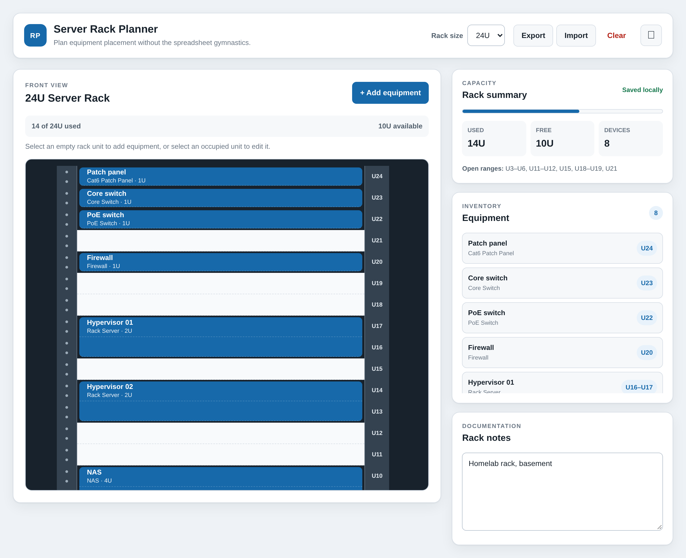

<p align="center">
  
</p>

<h1 align="center">RackPlanner</h1>

<p align="center">
  Plan your server rack in the browser. No backend, no build step, no spreadsheet gymnastics.
</p>

<p align="center">
  <a href="LICENSE"></a>
  <a href="#-quick-start"></a>
</p>

<p align="center">
  <a href="#-features">Features</a> ·
  <a href="#-quick-start">Quick start</a> ·
  <a href="#-usage">Usage</a> ·
  <a href="#-data-and-privacy">Data and privacy</a>
</p>

---

RackPlanner is a simple, browser-based tool for planning equipment placement in a server rack. Choose a rack size, add equipment to available rack units, keep configuration notes, and export the finished layout as JSON.

<p align="center">
  <picture>
    <source media="(prefers-color-scheme: dark)" srcset="assets/screenshot-dark.png">
    
  </picture>
</p>

> [!NOTE]
> RackPlanner runs entirely in the browser. It has no build step, dependencies, account, or backend.

## 🎯 Features

| Feature                      | What it does                                                                               |
| ---------------------------- | ------------------------------------------------------------------------------------------ |
| 📏 **Any rack size**         | Plan racks from 2U to 64U.                                                                 |
| 🧱 **Real placement rules**  | Reserve contiguous units for multi-U devices, with no overlaps or out-of-bounds placement. |
| 🏷️ **Equipment types**       | Common server, network, storage, patch-panel, power, and accessory types.                  |
| 📊 **Capacity at a glance**  | Used and free units, open ranges, and a full equipment inventory.                          |
| 📝 **Notes**                 | Notes for the rack as a whole and for each device.                                         |
| 💾 **Autosave**              | The current plan is kept in browser storage automatically.                                 |
| 📦 **Import and export**     | Save plans as JSON and load them again later.                                              |
| 🌗 **Light and dark themes** | Follows your system, with a manual toggle.                                                 |
| 📱 **Responsive**            | Accessible layout on desktop and mobile browsers.                                          |

## 📋 Requirements

- A modern web browser (current Firefox, Chrome, Edge, or Safari).
- Optional: Python 3 to serve it locally.

## 🚀 Quick start

### Open directly

Clone the repository and open `index.html` in a web browser:

```bash
git clone https://github.com/tylxr59/RackPlanner.git
cd RackPlanner
```

Then double-click `index.html`, or open it from your browser.

### Run a local server

Some browsers behave more consistently when the app is served over HTTP. From the project directory, run:

```bash
python3 -m http.server 8000
```

Then visit [http://localhost:8000](http://localhost:8000).

## 🧭 Usage

1. Select the rack size from the **Rack Size** menu.
2. Click an empty rack unit to add equipment at that position.
3. Enter a name, type, size, location, and any optional notes.
4. Click occupied equipment to edit, move, resize, or delete it.
5. Add general configuration details in the **Notes** section.
6. Use **Export** to create a portable JSON backup of the plan.

To restore a saved plan, select **Import** and choose a previously exported file. **Clear** removes every equipment item from the current rack after confirmation.

> [!NOTE]
> Changing to a smaller rack removes equipment that no longer fits, but only after you confirm the change.

## 🔐 Data and privacy

Rack data is stored locally in the browser using `localStorage`. Nothing is sent to a server by this application. Browser data can be cleared by browser settings, private-browsing behavior, or storage cleanup, so export important configurations as JSON backups.

An exported plan has this structure:

```json
{
  "schemaVersion": 2,
  "rackSize": 42,
  "equipment": [
    {
      "id": "550e8400-e29b-41d4-a716-446655440000",
      "name": "Core Switch",
      "type": "Core Switch",
      "size": 1,
      "notes": "Primary distribution switch",
      "startPosition": 40
    }
  ],
  "notes": "Main network rack",
  "exportDate": "2026-01-01T12:00:00.000Z"
}
```

## 🩺 Troubleshooting

| Symptom                                       | Fix                                                                                                    |
| --------------------------------------------- | ------------------------------------------------------------------------------------------------------ |
| A saved plan disappeared                      | Browser storage was cleared or you're in a private window. Import your last JSON export.               |
| "The saved plan was invalid"                  | The stored plan couldn't be read, so a new rack opened. Import a JSON export to restore it.            |
| Equipment vanished after changing rack size   | Shrinking the rack removes equipment that no longer fits, after you confirm. Import an export to undo. |
| Something behaves oddly when opened as a file | Serve it over HTTP instead. See [Run a local server](#run-a-local-server).                             |

## 👋 Development

There's nothing to install or build. Edit the files, then reload the page in your browser.

```text
RackPlanner/
├── index.html   # Application markup and equipment form
├── scripts.js   # Rack state, rendering, persistence, and import/export
├── styles.css   # Responsive light and dark themes
├── assets/      # Logo and screenshots
├── LICENSE      # MIT license
└── README.md
```

Contributions are welcome. Fork the repository, create a focused branch, make and test your changes in a modern browser, and open a pull request describing what changed.

When reporting a bug, include the browser and operating system, steps to reproduce it, and the behavior you expected.

## 📃 License

RackPlanner is available under the [MIT License](LICENSE).
